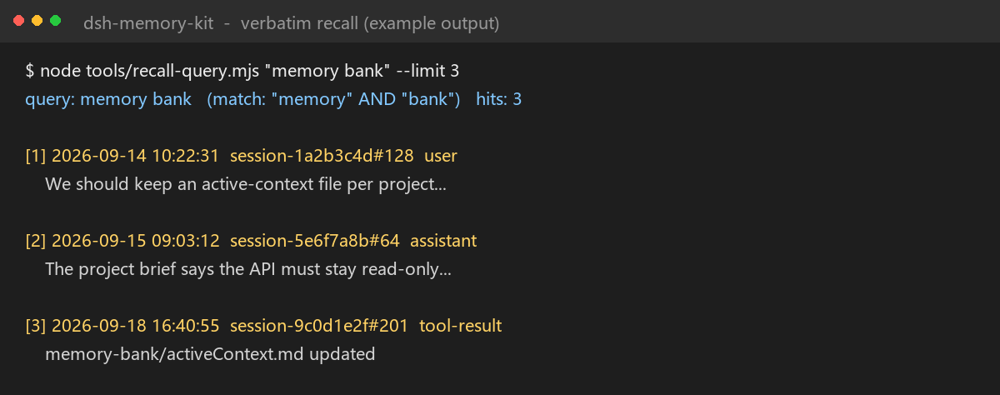
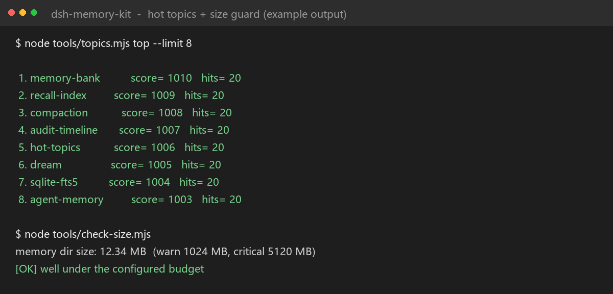

# dsh-memory-kit

给 [DeepSeek Harness](https://github.com/deepseek-ai/deepseek-harness)（DSH）用的**跨会话记忆工具包**：
纯文件 + `node:sqlite` + 定时脚本，**不需要装插件**。

## 它能做什么

- **逐字回溯（recall）**：把历史会话索引进 FTS5，压缩后或新会话里能把原话捞回来；
- **审计流 AUDIT.log**：把会话事件编译成一行一条的时间线（USER / AI / TOOL / APPROVAL / COMPACTION），带 `web` / `im` 来源；
- **情景日志 L2-EVENTS/**：按来源和日期分文件；
- **热度话题**：用 SQLite 复刻 Redis ZSET（score / 独立 expire / refs 指向事件），也支持模型提炼话题；
- **dream 巩固**：每天把事件提炼成稳定事实；
- **压缩快照**：会话被压缩时生成最小上下文快照。

## 截图




> 示例输出，数字来自演示数据。

## 要求

- DSH **0.2.x**（事件结构按这个版本写的）
- **Node.js >= 22.19**（`node:sqlite` + zstd）
- Windows（提供的 `.ps1` 是 Windows 脚本；`.mjs` 本身跨平台）

## 快速开始

```bash
cp config.example.json config.json   # 改成你的三个路径
node tools/recall-index.mjs
node tools/recall-query.mjs "关键词" --limit 10
```

把 `templates/` 复制到记忆目录（默认 `<workspace>/memory`），然后：

```bash
node tools/audit-compile.mjs
node tools/topics.mjs build
node tools/check-size.mjs
```

Windows 定时（可选）：

```powershell
powershell -ExecutionPolicy Bypass -File tools\memory-tick.ps1
powershell -ExecutionPolicy Bypass -File tools\setup-memory-task.ps1   # 每 30 分钟，自动提权
```

## 配置

`config.mjs` 的优先级：环境变量 > `config.json` > 默认值。

| 键 | 环境变量 | 默认 |
| --- | --- | --- |
| `workspace` | `DSH_MEMORY_WORKSPACE` | 当前目录 |
| `memoryDir` | `DSH_MEMORY_HOME` | `<workspace>/memory` |
| `sessionsRoot` | `DSH_SESSIONS_ROOT` | `~/.dsh/sessions` |

## 隐私

**不要提交** `memory/`、`db/`、`AUDIT.log`、`L2-EVENTS/`、`reinject/`、`backups/`、`config.json`——
这些是你的会话数据和本机路径，`.gitignore` 已经排除。

## 限制

- 事件结构绑定 DSH 0.2.x；
- PowerShell 脚本只面向 Windows；
- **没有插件就无法真正自动注入**：压缩后靠 AGENTS.md 协议去读 `reinject/latest.md`；
  想全自动需要写插件订阅 `compaction/*`；
- 没有模型话题时，中文 n-gram 会有一些泛词。

## 常见问题

更多问题见 [中文 FAQ](docs/FAQ.zh.md)。

## 许可证

MIT
